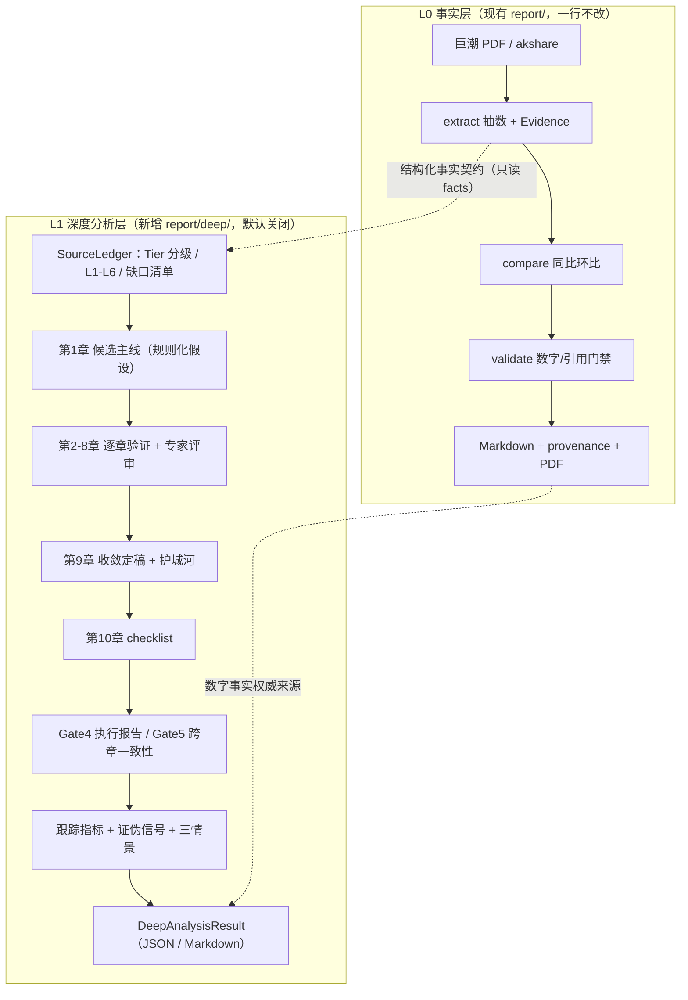

# 财报深度分析改造方案（公司 + 行业）

> 对照框架：`investment-deep-analysis` v2.0（数据溯源协议 / 10 章假设验证闭环 / 12 专家 5 轮评审 / 跟踪证伪）
> 目标项目：`ai_agent_backend` 的 `report/` 财报研报流水线
> 日期：2026-11-08

---

## 0. 结论先行

**这不是「把 9 节大纲写深一点」的量变，而是两套不同范式的系统。**

| | 现有 `report/` | 深度投资分析 |
| --- | --- | --- |
| 回答的问题 | 数字是多少、从哪来、同比多少 | 公司凭什么赚钱、这个判断可不可信、什么信号会证伪 |
| 产物性质 | 带溯源的**数据底稿** | 可证伪的**假设集合** |
| 核心资产 | 防幻觉门禁、确定性数字路径 | 分析框架、跨章交叉验证、评审记录 |
| 对推断的态度 | 一律禁止 | 允许，但必须显式标注、带证据、配证伪信号 |

现有流水线的工程质量很高（表格抽数、单位折算、口径指纹、同比环比、正文数字白名单、
9 列溯源附件、审核定稿门禁），**这套东西必须原样保留**。问题在于它被设计成「绝不推断」，
而深度分析的 10 章里，绝大多数结论（杜邦拆解、护城河评级、上下游地位、管理层、
提价提量可能、情景概率）都属于推断或有证据的推论，会被现有门禁直接拦掉。

因此架构结论是：**分层，不是改造**。L0 事实层保持不变，新增 L1 深度分析层，两层之间
用结构化事实契约连接；Markdown 正文与溯源附件永远是纯事实层，推断内容只在深度层出现。
第三轮起支持把推断层作为**带警示标注的附录**追加到同一份 PDF（默认），但绝不改写正文
页面，且合并档强制人工审核、禁止自动定稿（见 5.6）。

---

## 1. 现状定位（有出处的判断）

| 能力 | 现状 | 位置 |
| --- | --- | --- |
| 数字路径 | 确定性代码，零模型口算 | `report/pipeline.py:3-20`、`compare.py`、`validate.py` |
| 唯一 LLM 参与点 | 单公司「经营解读」一节 | `report/analyze.py:82`、`prompts/report_analysis.py:11-43` |
| 归因边界 | 三级：数据事实 / 原文引述 / 禁止第三方推断 | `prompts/report_analysis.py:13-23` |
| 赛道行业 | **不跑 LLM**，只做组内宽表 + 结构梯队 + 原文引述 | `next.md:31`、`report/analyze.py:102-131` |
| 对外定位 | 单公司叫「财报深度分析」，赛道叫「财报对比底稿」 | `README.md:123-128` |
| 章节结构 | 公司 9 节 / 通用行业 5 节，大纲是「数据罗列型」 | `skills/company_financial_report/SKILL.md:19-55` |
| 时间跨度 | 本期 + 同比基期 + 累计基期，约 3-4 期 | `report/pipeline.py:239-267` |
| 数据源 | 巨潮季报/半年报 PDF + akshare 结构化摘要 | `kb/cninfo.py`、`report/market_finance.py` |
| 评测 | 检索 / 图谱 / 记忆 / 工具选择，**无研报分析质量评测** | `README.md:276-334` |
| 成本核算 | 全链路无 usage/token 统计 | `llm/client.py:235-282` |

一句话：这是一个可靠的「带溯源的财报数据底稿生成器」，不是分析系统。

---

## 2. 差距矩阵

### 2.1 公司财报分析的缺口

| 技能章节 | 要求 | 现状 | 缺口等级 |
| --- | --- | --- | --- |
| 1 候选主线 | 五规则扫描、初始链条假设、公司类型分支 | 无，只有「本期结论」复述指标 | 高 |
| 2 财报可信度 | 近 5 年审计意见、KAM、政策变更、问询函 | 无，且季报不含审计报告 | 高（数据 + 框架双缺） |
| 3 造假可能性 | 现金流/利润匹配、M-Score、舞弊三角 | 无 | 高 |
| 4 ROE | 杜邦三分解、类现金剔除、同行对照 | 无，`indicators.yaml` 是抽数指标集不是分析维度集 | 高 |
| 5 资产负债表叙事 | 资金流向表、三流匹配、言行对照 | 只有「较上年末变动」原文句 | 高 |
| 6 业务与行业格局 | 分业务、供给/产能份额、提价提量、价格战、对照组 | 无分部数据、无行业统计 | 高 |
| 7 管理层 | 六维评估、承诺兑现、资本配置回溯 | 无 | 高 |
| 8 上下游地位 | 应收应付结构、客户集中度、占款能力 | 有合同负债等孤立指标，无地位判断 | 中高 |
| 9 护城河 | 链条收敛、五来源评级、不可复制性实证、交叉印证 | 无 | 高 |
| 10 checklist | 逐项 ✅/⚠️/❌、五偏差自查、总评 | 无 | 中 |
| 跟踪证伪 | 先行指标、证伪信号、三情景概率 | 无 | 高 |
| 结构化结论 | 可查询/可比对/可回查的结论对象 | 只有 Markdown 字符串 + `_payload` 字典 | 高 |

### 2.2 行业财报分析的缺口（比公司侧更弱）

`industry_report/SKILL.md` 只有 5 节（覆盖范围 / 指标与出处 / 同比 / 公司间对比 / 缺失说明），
赛道版扩到 8 节但仍以组内宽表为主。对照技能第 6 章，缺：

- 供给结构（全行业 + 细分品类产能份额，与收入口径 CR 并列对比）
- 集中度与格局演进、进入壁垒、替代品威胁
- 提价 / 提量评级、产能-价格传导、历史价格战与对手反制
- **对照组思维**：公司变化 − 同行同期变化 = 净效果（区分行业 β 与公司 α）
- 行业量价、协会统计、政策与宏观数据源（`industries.yaml` 里明确列为「下期预告，本期不推断」）
- 花名册硬编码（半导体 8 家 / 机器人 8 家 / 银行 23 家），无动态行业边界

**重要边界**：技能 v2.0 明确「不适用于无具体标的的行业宏观分析」。所以行业侧**不能硬套 10 章**。
正确做法是把行业报告重构成「公司深度分析的共享证据层 + 竞争格局模块」：
财报可信度 / 造假 / 管理层 / 个人 checklist 是单公司个体属性，横比时裁掉；
保留可比与格局类章节，并强制注入对照组验证。本方案已按此裁剪（见 4.2）。

### 2.3 三大机制对照

| 技能机制 | 项目已具备 | 还差什么 |
| --- | --- | --- |
| 数据溯源协议 | `IndicatorFact` / `Evidence` / `citation_anchor` / 9 列 provenance，约 80% | Tier 分级、L1-L6 源头优先级、引用链回溯（L4 必须回溯 L1-L3）、数据来源表、缺口清单、**近 5 年年报/审计/问询函数据源** |
| 10 章闭环 | 无 | 假设生成 → 逐章验证 → 第 9 章收敛 → 第 10 章过滤的全流程；结论对象化 |
| 12 专家 5 轮评审 | `validate.py` 只校验数字与引用；`review.py` 是人工定稿门禁 | 分析质量评审、视角配置、意见必须采纳/驳回、评审记录落盘 |
| 跟踪证伪 | 无 | 先行指标、证伪信号、三情景概率，且要能后续回查修订 |

---

## 3. 为什么不能「往现有大纲里加章节」

`prompts/report_analysis.py` 的硬性禁止里写着：禁止同业均值、行业区间、估值、
未授权数字、无证据因果；`report/validate.py` 会把正文里任何不在 `_allowed` 集合里的数字判 error，
`pipeline.py:178-197` 据此禁止渲染 PDF。

于是深度分析需要的「杜邦三分解 42.5%」「行业 CR5 68%」「产能份额 12%」要么抽不到、
要么被门禁拦掉；`next.md:31` 更直接规定赛道报告不跑 LLM。**不放松门禁就写不出深度结论，
放松门禁就等于把项目最核心的防幻觉资产拆了**。这是本次改造最关键的约束，也是选择分层的理由。

---

## 4. 架构：分层而不是改造



### 4.1 组件职责

| 组件 | 文件 | 职责 |
| --- | --- | --- |
| 结论对象 | `deep/schema.py` | 三分标注、Tier、来源表、缺口、评审记录、跟踪证伪、执行报告；`to_dict/to_json/to_markdown` |
| 章节定义 | `deep/chapters.py` | 10 章必查项/数据要求/方法映射/输出契约、12 专家视角、行业章节裁剪、五规则 |
| 溯源台账 | `deep/ledger.py` | 适配 `IndicatorFact`、Tier 分级、L4 二手数据回溯校验、数字白名单、缺口登记 |
| 提示词 | `deep/prompts.py` | 章节/评审/收敛三套 system + JSON 契约 + 护栏 |
| 分析与评审 | `deep/analyzer.py` | JSON mode 降级、`load_llm_json`、后处理硬门禁、评审意见合法性校验 |
| 编排 | `deep/pipeline.py` | Gate 0-5、预算闸、候选主线规则、收敛、checklist、交叉验证、成本估算 |

两层之间的契约是 `SourceLedger.from_facts(facts)`：只读事实层产出的
`IndicatorFact`，不 import 其类、不修改其字段、不调用其门禁函数。
**推断产物只在 L1 的 JSON/Markdown 里出现，报告头显式声明「以 L0 底稿为数字权威」**。

### 4.2 行业侧的章节裁剪

| 模式 | 启用章节 | 跳过 | 理由 |
| --- | --- | --- | --- |
| `company` | 1-10 全量 | — | 完整假设验证闭环 |
| `industry` | 1、4、5、6、8、9 | 2、3、7、10 | 可信度/造假/管理层/checklist 是单公司个体属性；第 6 章为行业核心，强制注入对照组净效果口径 |

### 4.3 技术选型对比

| 方案 | 防幻觉 | 推断能力 | 改动面 | 可评测性 | 结论 |
| --- | --- | --- | --- | --- | --- |
| A. 扩现有 9 节大纲 | 保持 | 无（门禁拦掉） | 配置级 | 只能测数字正确性 | ❌ 解决不了深度问题 |
| B. 放宽现有门禁让 LLM 自由写 | **破坏** | 强但不可控 | 核心门禁 + 885 用例 | 难 | ❌ 拆掉项目核心资产 |
| C. 独立分析层 + 结构化契约（推荐） | 保持 | 显式标注、可审计 | 零侵入新增 | 结构化字段可断言 | ✅ |
| D. 全部交给一个多 Agent 框架 | 弱 | 强 | 引入新依赖、重写链路 | 难复现 | ❌ 当前阶段过重 |

选 C 的额外理由：项目已有 885 个用例和成熟的数字门禁，任何改动核心的路线都要付回归代价；
而深度分析的质量目前**无法评测**，先做成可插拔、可 A/B 的独立层，才能在不动生产的前提下跑 bad case。

---

## 5. Phase 1 已落地（本轮交付）

新增目录 `src/ai_agent/report/deep/`（7 个模块）与 `tests/test_report_deep_*.py`（4 个文件）。

**默认零侵入**：`DeepConfig.enabled=False` 且未注入补全函数时只产出零 token 骨架
（台账 + 候选主线 + 缺口 + checklist + 交叉验证）；`run_report` 未改一行，
既不注册新工具、也不新增 API 端点、不新增 settings 字段、不改 `.env.example`。

调用方式（Phase 1 手动入口）:

```python
from ai_agent.report.pipeline import run_report
from ai_agent.report.deep import DeepConfig, run_deep_analysis

base = run_report("生成兆易创新 2026Q3 财报深度分析")
deep = run_deep_analysis(
    "兆易创新", base.plan.period, base.facts,
    config=DeepConfig(enabled=True, review_rounds=2),
)
deep.to_json()       # 结构化结论，可落盘 / 比对 / 证伪回查
deep.to_markdown()   # 给人看的报告
```

已实现的硬门禁（不是只写在提示词里）：

- 正文数字必须在台账白名单内，模型心算的比率/均值一律丢弃；
- `inferred` 无 `evidence_ids` 直接丢弃，`inferred` 置信度 ≤0.7、`uncertain` ≤0.4；
- 估值/目标价/买卖建议关键词拦截；
- L4/L5 二手数据未回溯到 L1-L3 源头 → 拒绝入数据来源表并记缺口；
- 评审意见必须采纳或书面驳回，空驳回（「我认为没问题」）直接丢弃；
- `max_llm_calls` 硬预算闸，触发后剩余章节标 `skipped` 并在执行报告里说明，不静默缩水；
- LLM 失败/输出不可解析 → 章节降级 `fallback`，不中断整份报告（沿用 `analyze.py` 的成熟模式）。

**验证**：

- `ruff check`（新包 + 4 个测试文件）：零告警；
- 新增 23 个单测全绿（stub LLM，零真实 token），覆盖硬门禁、溯源台账、行业裁剪、预算闸、Gate 4/5；
- 全量 `pytest -q`：**1264 passed / 20 failed / 13 errors**（共 1297 个用例，仓库当前实际规模已大于 README 记录的 885）。
  这些失败**与本次改动无关**：`git status` 显示本次只新增 6 个未跟踪路径、零既有文件修改；
  失败分两类——① `AttributeError: ai_agent.core.http does not have the attribute '_fetch'` 等
  存量测试与实现的接口漂移（test_gate / test_http / 部分 test_report_*）；
  ② `FileExistsError` 来自运行环境对 pytest `tmp_path` 的路径代理（sitecustomize shim），
  非业务代码。建议单独排期清理这批存量红灯，不要误判为深度分析层引入。

---

## 5.5 Phase 2 + Phase 3 已落地（第二轮交付）

用户在四个待确认点里拍板了 **② 外部数据源范围** 与 **③ 挂进 `run_report`**。
本轮按推荐默认值落地；①④ 当时尚未拍板，后续分别见 5.6 与 5.7，
四个决策现已在第 10 节全部标为已拍板。

### 5.5.1 外部数据源：契约 + 盘点 + 注入通道

新增 `src/ai_agent/report/deep/sources.py`。按「近 5 年定期报告 → 审计报告/问询函
→ 行业统计」的优先级设计，前两类做成可运行，行业统计只留注入点。

```
SourceProvider (Protocol)
├── KnowledgeBaseProvider   store.list_kb_files() 只读盘点近 5 年源文件
│                           → SourceDocument + 具体到章节的缺口清单（不产生事实）
├── LocalFactsProvider      本地 .json/.jsonl 结构化事实清单 → ExternalFact
│                           （唯一能把数字喂进 SourceLedger 的通道）
└── IndustryStatProvider    fetcher(target, period, years) 注入点
                            未注入 → 明确声明第 6/9 章缺口，绝不编造数据或端点
```

**刻意守住的诚实边界**（这是本轮最重要的设计判断）：库里有一份年报 PDF
≠ 已经抽出附注里的数字。所以 `KnowledgeBaseProvider` **不产生 `ExternalFact`**，
只做覆盖度盘点，并把「缺哪类文件」从笼统的「数据不足」变成带章节归属与
处理办法的缺口，例如「近 5 年 `audit` 原文未入库 → 第 2 章财报可信度无法评级
→ 入库近 5 年审计报告与 KAM 原文」。PDF 附注解析、第三方站点抓取均不在本轮
范围，也没有内置任何外部 API 端点。

`LocalFactsProvider` 的清单格式（每行一项，字段与 `ExternalFact` 对齐）:

```json
{
  "facts": [
    {
      "item": "分部收入-存储芯片", "value": "1,234,567",
      "source_file": "甲公司2024年年度报告.pdf", "location": "第88页",
      "quote": "存储芯片分部收入 1,234,567 元",
      "period": "2024Y", "subject": "甲公司",
      "doc_type": "annual", "level": "L1", "chapters": [4, 6]
    }
  ]
}
```

`value` 必须是源文原文值，不允许在清单里做二次计算；`level` 未知按 L4 处理，
L4/L5 没有 `backtrace_to` 一律由 `SourceLedger.add_external` 拒绝入表并记缺口。
单文件 ≤2MB、总事实 ≤500 条，防止误放的大文件拖垮报告。

### 5.5.2 挂接 `run_report`：默认关闭的旁路

改动 4 个既有文件（都是加法，无删除、无语义变更）:

| 文件 | 改动 |
| --- | --- |
| `report/pipeline.py` | `run_report(..., deep: DeepOptions \| None = None)`；`ReportResult` 加 `deep_analysis` / `deep_artifacts` / `deep_error` / `deep_write_artifacts`；主产物定稿后跑旁路，异常隔离；`_write_artifacts` 单独落 `.deep.json` / `.deep.md` |
| `api/schemas.py` | `ReportRequest.deep: "off" \| "skeleton" \| "full"`，默认 `off` |
| `api/routers/report.py` | `create_report` 映射开关；`_payload` **仅在启用时**加 `deep` 段 |
| `report/cleanup.py` | 产物正则补 `.deep.md` / `.deep.json`，否则旧版清理会留孤儿文件 |

**隔离保证**：深度产物不写进 `document.markdown`、不进 `ReportArtifacts`
（`review.create_record` 用 `asdict(result.artifacts)` 算内容指纹，所以 M2 审核
指纹逐字节不变）、不参与 `parse/extract/compare/compose/validate/PDF` 任何一步。
`deep=None` 时连 `report.deep` 包都不会被 import，既有链路零开销、零行为变化；
深度层抛异常只写 `deep_error`，主报告照常交付。

三档用法:

```python
from ai_agent.report.pipeline import run_report
from ai_agent.report.deep import DeepOptions

# 1) 默认：完全不跑
base = run_report("生成兆易创新 2026Q3 财报深度分析")

# 2) 零 token 骨架：先验收数据覆盖度，再决定要不要烧钱
skeleton = run_report(..., deep=DeepOptions(enabled=False))
print(skeleton.deep_analysis.all_gaps)   # 缺哪几类源文件，具体到章节

# 3) 完整 10 章
full = run_report(..., deep=DeepOptions(enabled=True, years=5,
                                        facts_dir="data/deep_facts"))
full.deep_artifacts   # {"json": "...deep.json", "markdown": "...deep.md"}
```

HTTP 侧：`POST /v1/report` 传 `"deep": "skeleton" | "full"`；`off` 时响应
**不新增任何键**。聊天工具 `report_generate` 刻意不暴露该开关，避免 LLM 误触发
昂贵调用。

**同步超时风险（需要知晓）**：`full` 约 31 次模型调用 / 1.5-4 分钟，而
`POST /v1/report` 是同步路由（FastAPI 丢线程池）。部署时网关超时必须大于该
时长，否则会拿到 504 但服务端仍在跑。生产化建议下一步改异步任务 + 轮询进度，
本轮未做（见第 6 节剩余项）。

**验证**：第二轮新增 29 个单测（stub，零真实 token，含 `full` 档完整 10 章端到端），
深度层合计 **52 个用例全绿**，`ruff check`（新增包 + 改动的 4 个既有文件 +
6 个测试文件）零告警。
全量 `pytest -q`：**1293 passed / 20 failed / 13 errors**（上轮为
1264 passed / 20 failed / 13 errors）——通过数恰好 +29，失败与错误数**一个没多**。
`git diff --stat` 显示 4 个既有文件仅 `+86 -2`、全部为加法；逐个复核失败堆栈可见
它们是存量文案/单位断言漂移（如 `"取数列：年初至报告期末"`、`"526,365百万元"`）、
`ai_agent.core.http._fetch` 接口漂移、以及沙箱 shim 对 pytest `tmp_path` 的
`FileExistsError`，`ReportResult` 的 repr 里 `deep_analysis=None` 也印证默认分支未执行。
结论：本轮改动**未引入任何新的失败**，存量红灯建议单独排期清理。

---

## 5.6 Phase 2.5 已落地：深度分析合并进现有 PDF（第三轮交付）

用户在决策 ① 上拍板 **「合并进现有 PDF」**。这不只是换个落盘位置：它会改变
「PDF = 已核验事实」这个产品语义，所以配套重定义了审核门禁。

### 5.6.1 版面与标注（防误读三层）

| 层 | 实现 | 作用 |
| --- | --- | --- |
| 分页 | 附录 `break-before: page` + 左侧警示色边框 | 正文页面一页不改，附录从新页开始 |
| 页眉 | `position: running(deep-flag)`，仅附录页出现「推断层 · 未经事实层校验」 | 翻到中间页也看得到；复用项目 Logo 已在用的机制，**不依赖 WeasyPrint named page**，避开版本兼容风险 |
| 内容 | 首页警示框 + 每条结论【已知】/【推断】/【不确定】+ Tier + 证据 id + 置信度，推断/不确定行单独底色 | 一眼区分财报事实与模型判断 |

附录里明确写清：情景概率与置信度是**模型主观赋值**，不是财报披露值；附录数字只来自
`DeepAnalysisResult`（已被 analyzer 台账硬门禁过滤），不进 `validate.py` 的允许数字
集合。所有来自 LLM / 外部数据源的文本一律 `html.escape`，防止 `<script>` 之类注入
进 PDF 的 HTML。

### 5.6.2 门禁重定义（本轮最关键的一处）

合并前，`review.create_record` 在「校验通过且无待审异常」时会**自动定稿**，PDF 随即
允许下载。若照旧，等于给未审推断盖章。处理方式：

1. `run_report` 在合并成功后往 `validation.review_queue` 追加一条
   `ReviewItem`：「深度分析附录已合并进 PDF：…需人工确认推断标注、证据边界与免责声明」；
2. `create_record` 据此生成一条 pending 审核项 → `clean=False` → 不自动定稿；
3. `gate()` 因 `pending_items` 拒绝定稿，`pdf_download_gate()` 返回 409，
   直到管理员 approve + finalize。

**`review.py` 一行未改**，原有硬门禁（校验有 error 不出 PDF、定稿后改文件自动作废审批）
全部保留。指纹方面：`create_record` 本来就在 `_write_artifacts` 之后调用，
`content_hash` 读到的是最终合并 PDF 字节，不会失配；`ReportArtifacts` 仍只登记
md / provenance / review / pdf 四个键，深度文件不进审核指纹。

### 5.6.3 开关与降级

| 入口 | 值 | 行为 |
| --- | --- | --- |
| `POST /v1/report` | `deep: "off"`（默认） | 完全不跑，`deep_pdf` 忽略，响应不新增任何键 |
| | `deep: "skeleton"/"full"` + `deep_pdf: "merge"`（默认） | 同一份 PDF 末尾追加附录 + 强制人工审核 |
| | `deep_pdf: "separate"` | 回退第二轮行为：PDF 纯事实层、深度结论只落独立文件、可自动定稿 |
| Python | `DeepOptions(pdf_mode="merge"/"separate")` | 同上 |

自动退化：markdown 交付、校验未通过被挡住、PDF 渲染降级这三种情况没有 PDF 可合并，
自动走 separate。合并重渲染失败时**保留原事实层 PDF**，只写 `deep_pdf_error`，
`deep_error` 保持空（深度分析本身没失败），也不会误追加审核项把纯事实层 PDF 卡住。

合并档多一次 WeasyPrint 渲染（数秒量级），文件名、下载端点、产物清理正则都不变。

**验证**：第三轮新增 8 个单测（PDF 渲染打桩、零真实 token / 零字体依赖），覆盖
默认零变化、附录标注与 HTML 转义、merge 强制人工审核、separate 自动定稿、
合并失败回退、markdown 交付不合并、API 默认值；深度层合计 **60 个用例全绿**，
`ruff check`（新增包 + 本轮改动的 4 个既有文件 + 新测试）零告警。
全量 `pytest -q`：**1301 passed / 20 failed / 13 errors**（上轮为
1293 passed / 20 failed / 13 errors）—— 通过数恰好 +8，失败与错误数**一个没多**；
失败仍是存量文案/单位断言漂移、`_fetch` 接口漂移与沙箱 `tmp_path` 的
`FileExistsError`。`pdf.py` 的模板函数新增可选参数且不传时输出逐字节不变，
`test_report_pdf.py` 的真实渲染用例（除沙箱 error 外）全部通过。

---

## 5.7 决策 ④ 已落地：分章模型策略 + 收敛质量门禁（第四轮交付）

**拍板结果**：章节分析与专家评审走 `SMALL_MODEL`（本地网关），**第 9 章收敛
及其终审走主模型**（`MODEL` + 主网关）。曾在「全流程小模型」与「全流程主模型」
之间权衡，最终取中间方案：收敛是整份报告最吃推理能力的一步（`CONVERGENCE_SYSTEM`
要求把断言向下追问到物理/时间/量化实证/历史实证终点），而其余 28 次调用是
结构化抽取与核对，小模型够用；全流程换主模型成本约 10 倍，边际收益不划算。

### 5.7.1 修掉一个真实的静默漂移

改前 `DeepConfig.model=""` → `default_complete` → `lightweight_llm("")`。
核对 `llm/client.py:55-68` 后发现：该函数在 `SMALL_MODEL` **未配置时会静默退回
主模型 + 主网关**，且 `ExecutionReport` 完全没有记录实际模型名——既违背「走小模型」
的决策，也无法做 A/B 归因与成本核对。本轮新增纯函数 `resolve_model_plan()`：

| `model_route` | 含义 |
| --- | --- |
| `none` | 零 token 骨架，完全不读取模型配置 |
| `injected` | 外部注入补全函数（单测 / A/B），模型名不由本层解析 |
| `small+primary` | **默认**：章节 SMALL_MODEL + 第 9 章主模型 |
| `all-primary` | `SMALL_MODEL` 未配，两条通道都退回主模型（**显式告警**） |
| `all-small` | 两条通道同为小模型（显式回退或配置使然） |
| `override` | 显式指定了业务模型名 |

`chapter_model=""` 是刻意保留的：交给 `lightweight_llm` 自己走本地网关；
`convergence_model=settings.model` 则会命中「显式模型名 → 主网关」分支。
**没有新增任何 SDK 方法或网关参数**，只复用项目既有语义。

### 5.7.2 第 9 章收敛质量门禁（代码级，不靠提示词自觉）

`CONVERGENCE_SYSTEM` 的四条硬要求原先只有提示词约束，换主模型也不保证不退化。
本轮新增 `assess_convergence()` 纯函数，检查：

1. 核心链条是否停在断言层（「品牌强 / 技术领先 / 壁垒高」等标记 + 无机制/实证表述）；
2. 护城河五大来源覆盖度（< 4/5 记完整性缺口）；
3. 全部候选主线是否被确认 / 修正 / 推翻；
4. 三情景概率是否 3 档且合计 1±0.05；
5. 证伪信号与跟踪指标是否齐备。

判定 `solid` / `shallow` / `incomplete`，**只标注、不删改结论**，不承诺准确率。
判定写入 `ExecutionReport.convergence_quality` / `convergence_checks`，并在
`to_markdown()` 执行报告、第 10 章 checklist、Gate 5 跨章审查，以及**合并进 PDF 的
附录 A / 附录 D** 中可见——审核人能在同一份定稿件里看到「本次收敛被判为浅层」。

### 5.7.3 配置与 A/B 入口

```python
from ai_agent.report.deep import DeepConfig, run_deep_analysis

DeepConfig(enabled=True)                              # 默认：章节小模型 + 第9章主模型
DeepConfig(enabled=True, convergence_model="<小模型名>")  # 退回全流程小模型
DeepConfig(enabled=True, model="<主模型名>")            # 全流程主模型（成本约 10 倍）
run_deep_analysis(..., convergence_complete=stub)      # 只替换第 9 章通道，做单章 A/B
```

`route` 描述的是**实际生效**的两条通道而非配置写法（例：显式把收敛模型设回
小模型名时识别为 `all-small`）。建议用评测集量化 `shallow` 占比，再决定是否
进一步上调第 9 章模型，而不是凭感觉换模型。

**验证**：第四轮新增 15 个单测（零真实 token），覆盖默认零行为不变、两条通道
分流、`SMALL_MODEL` 缺失告警进 `notes`、真实路由记录进 `ExecutionReport`、
质量三档判定、Markdown 与 PDF 附录可见性；深度层合计 **75 个用例全绿**，
`ruff check`（`deep/` 包 + 新测试）零告警。
全量 `pytest -q`：**1316 passed / 20 failed / 13 errors**（上轮为
1301 passed / 20 failed / 13 errors）—— 通过数恰好 +15，失败与错误数**一个没多**；
逐个复核仍是存量文案/单位断言漂移、`_fetch` 接口漂移与沙箱 `tmp_path` 的
`FileExistsError`。本轮未修改任何既有文件（`git diff --stat` 仍为前三轮累计的
`+219 −13`），改动全部落在新增的 `deep/` 包与新测试文件里。

---

## 6. 后续路线

| 阶段 | 内容 | 状态 |
| --- | --- | --- |
| Phase 2 | `run_report` 旁路挂接；深度结论独立落 JSON/MD、不进正文；API 三档开关 | ✅ 已落地 |
| Phase 3 | 数据源契约：源文件盘点、近 5 年窗口、具体到章节的缺口清单、本地结构化事实注入、行业统计 fetcher 注入点、L4/L5 回溯门禁 | ✅ 已落地 |
| Phase 2.5 | 推断层附录合并进现有 PDF（默认）+ 警示标注 + 审核门禁重定义（禁止自动定稿）+ `separate` 回退 | ✅ 第三轮已落地 |
| 决策 ④ | 分章模型策略（仅第 9 章收敛+终审用主模型）、模型路由可观测与漂移告警、第 9 章收敛质量门禁 | ✅ 第四轮已落地 |
| Phase 2 剩余 | 章节间并发把延迟压到 30-60s；异步任务 + 进度轮询；接 `usage` 做真实 token 统计（当前是字符 /1.5 粗估） | ⏳ 未做 |
| Phase 3 剩余 | **PDF 附注/审计报告/问询函的结构化解析**（把源文件变成事实清单）；行业统计合规授权数据源接入；行业侧花名册动态化、第 6 章对照组净效果落地 | ⏳ 依赖数据/授权，代码绕不过去 |
| Phase 4 | 评测集 + A/B + 跟踪证伪闭环：结构化结论落 Postgres（现有 `review.py` 自注多副本需换行锁），证伪信号触发时回查章节并标记「假设被证伪」 | ⏳ 依赖评测标注人力 |

**Phase 3 是天花板，不是代码能绕过去的**：现有 `cninfo.py` 只拉季报/半年报 PDF 与摘要，
10 章里第 2/3/6/7/9 章所需数据大量只存在于年报附注、审计报告、问询函、行业统计里。
在这些 L1-L3 源头接入前，深度分析会诚实地输出大量数据缺口——这比编造结论好，但也意味着
「深度」的上限由数据源决定，不是由提示词决定。

---

## 7. 成本与延迟估算

按 `company` 模式默认配置（`review_rounds=2`，3 个评审视角，同轮多视角合并进一次调用）：
第 2-8 章各 1 次分析 + 3 次评审 = 28 次；第 9 章 1 次收敛 + 2 次评审 = 3 次；**合计约 31 次 LLM 调用**。

| 项 | 粗估 |
| --- | --- |
| 输入 token | ~70k（章节 prompt 含台账 40 条，约 3-5k 字符/次） |
| 输出 token | ~20k（实际 500-900 token/次，`max_tokens=1600` 封顶） |
| 全流程轻量模型（$0.15 / $0.60 per 1M in/out 量级） | ≈ $0.02-0.04 / 份（≈ ¥0.15-0.3） |
| 全流中大型推理模型（$3 / $12 per 1M 量级） | ≈ $0.45-0.75 / 份（≈ ¥3-5） |
| **决策 ④ 实际口径**：28 次轻量 + 3 次主模型（第 9 章收敛 + 终审） | ≈ **¥0.4-0.8 / 份**，约为全流程主模型的 1/6 |
| 串行延迟 | 31 × 3-8s ≈ **1.5-4 分钟**；主模型 3 次约多 10-30s |
| 章节并发后（Phase 2） | 目标 30-60s |

对比：若按技能原协议「12 专家 × 5 轮、每视角独立调用」实现，约 488 次调用、
1.1M 输入 token，中大型模型约 $7/份、串行延迟 30-40 分钟——**生产不可接受**。
本实现把同一轮的多个视角合并进一次调用，`full_panel=True` 只增加输入长度（约 +30-50%），
调用次数不变；这是明确的工程降级，已在执行报告里如实标注。

> 上述 token 为字符 /1.5 的粗估（项目当前无 `usage` 统计），真实计费以网关返回为准。
> 价格仅为量级参考，请以所用模型当期官方定价核算。

| 参数 | 推荐默认 | 调参方向 |
| --- | --- | --- |
| `review_rounds` | 2 | 质量优先调到 5（成本约 +70%）；预算紧调到 1 |
| `full_panel` / `experts` | 3 视角 | 全 12 视角提高盲区覆盖，输入 +30-50%，调用数不变 |
| `max_tokens` | 1600 | 本地小模型降到 900；主模型可 2000 |
| `temperature` | 0.1 | 结构化任务保持低值，调高会让章节结论抖动、评测不可复现 |
| `max_llm_calls` | 60 | 按预算设硬闸；超了标 skipped 而不是悄悄少写几章 |
| `model` | 空 → `SMALL_MODEL`/本地 | 章节与评审通道；显式填主模型名即全流程主模型（成本约 10 倍） |
| `convergence_model` | 空 → `MODEL`/主网关 | 第 9 章收敛与终审专用；填小模型名可退回全流程小模型，填别的值做单章 A/B |
| 台账 `limit` | 40 条 | 事实多时改成按章检索，别把全量台账塞进每章 prompt |

> 两条补全通道共用同一个 `_Budget` 实例，分章模型策略**不会让预算闸失效**；
> `SMALL_MODEL` 未配置时 `model_route=all-primary` 会显式告警，成本需按主模型重算。
> 价格仅为量级参考，请以所用模型/网关当期官方定价与 `usage` 实测为准。

---

## 8. 风险与应对

| 风险 | 应对 |
| --- | --- |
| 推断被误当事实 | 三分标注 + Tier + evidence_ids + 附录警示框/页眉标注 + HTML 转义；Markdown 正文永远不含推断；合并进 PDF 时**强制人工审核、禁止自动定稿**；`separate` 可回退纯事实层 PDF |
| 数据源不足导致「深度」名不副实 | 缺口显式声明、禁止臆测填补；Phase 3 数据源清单已列明，接入前不承诺效果 |
| 模型能力不足（停在断言层） | 第 9 章收敛与终审用主模型 + `assess_convergence()` 代码级门禁（判 `shallow` 并在 PDF 附录 D 明示）；评测集量化 shallow 占比后再决定是否继续升级；不承诺准确率 |
| 模型路由静默漂移 | `resolve_model_plan()` 解析实际模型名写进 `ExecutionReport` 与 PDF 附录 A；`SMALL_MODEL` 缺失进 `notes` 并 `logger.warning`，不再悄悄走主模型 |
| 成本/延迟失控 | 默认关闭、预算闸（两通道共用一个计数器）、token 粗估、仅 3/31 次调用用主模型、章节并发（Phase 2）、可降级到骨架模式 |
| 评审流于形式 | 空驳回拦截、每条意见必须采纳/驳回、评审记录随报告落盘 |
| 行业侧硬套 10 章 | 章节裁剪 + 对照组口径；技能边界写进 `chapters.py` 注释 |
| 版本/网关兼容 | `openai>=3.33.0` 的 `response_format` 并非所有网关支持，已实现去掉 JSON mode 重试一次；换模型/网关后必须回归 `tests/test_report_deep_*.py`。SDK 参数请以所用版本官方文档为准 |
| 安全合规 | API Key 继续走 `.env`，不进代码库；财报原文属用户上传件，沿用项目 `user_id` 隔离；深度分析产物若新增下载端点须过现有定稿门禁与管理员白名单 |
| 多副本部署 | 现有 `review.py` 自注审核状态存在文件 `_review/index.json`，多副本需换 Postgres + 行锁；深度分析结论落库时一并解决 |

---

## 9. 评测方案（Phase 4，建议先做 15-20 个 case）

| 指标 | 定义 | 目标 |
| --- | --- | --- |
| 数字幻觉率 | 结论里出现台账外数字的比例 | 0（硬门禁保证） |
| 推断标注率 | `inferred`/`uncertain` 被正确标注且带证据的比例 | 100% |
| 证据覆盖率 | 每条 `known` 结论能回指 source_id 的比例 | 100% |
| 缺口召回率 | 明知缺数据（无年报/无审计/无分部）时是否老实写 gap | ≥95% |
| 收敛深度通过率 | 第 9 章是否到达四类不可再拆终点之一，而非停在断言层 | 人工标注为金标准；`convergence_quality` 的三档判定可作**自动代理指标**，需先验证与人工标注的一致性 |
| 证伪可观测率 | 关键判断配了带阈值先行指标的比例 | ≥80% |
| 评审有效率 | 非空驳回、非泛泛而谈的意见占比 | 人工抽检 |

用例覆盖建议：数据充足的龙头 / 数据稀少的公司 / 有造假嫌疑样本 / 行业横比（含不可比口径）/
缺本期原文 / 缺同比基期 / 银行与半导体等不同口径。
A/B 三组：仅 L0 底稿 vs 深度层默认配置 vs `review_rounds=5 + full_panel`。
模型侧另有单章对照：注入 `convergence_complete` 或用 `convergence_model` 切换，
只比较第 9 章的 `shallow` 占比与人工收敛深度评分，避免把 31 次调用全换主模型来试错。
bad case 按三层归因定位：提示词契约问题 / 台账（检索与数据源）问题 / 模型能力问题，对症下药。

---

## 10. 决策状态（①②③④ 全部拍板）

| # | 决策 | 状态 |
| --- | --- | --- |
| ② | 外部数据源先接哪几类 | ✅ 已按「近 5 年定期报告 → 审计报告/问询函 → 行业统计」落地，前两类可运行，行业统计留注入点（见 5.5.1） |
| ③ | 是否挂进 `run_report` | ✅ 已挂，默认关闭、三档开关、深度结论不进 Markdown 正文（见 5.5.2） |
| ① | **推断能否进入对外交付物**：只出独立文件，还是合并进现有 PDF？ | ✅ 拍板**合并进现有 PDF**。已按「正文不改写 + 附录三层标注 + 强制人工审核」实现，另留 `deep_pdf:"separate"` 回退（见 5.6） |
| ④ | **模型选型**：全流程小模型 / 全流程主模型 / 仅第 9 章主模型？ | ✅ 拍板**仅第 9 章收敛与终审用主模型**，其余走 SMALL_MODEL。曾先选全流程小模型后改口（担心停在断言层）；最终取成本与质量的中间方案。已落地 `resolve_model_plan()` 路由可观测、`SMALL_MODEL` 缺失显式告警、收敛质量门禁（见 5.7） |

**接下来最该推的一件事**：把近 5 年年报附注 / 审计报告 / 问询函**解析成
`LocalFactsProvider` 的结构化事实清单**。当前盘点层能准确告诉你「缺什么」，
但只有事实清单能让第 2/3/4/6/7/9 章真正跑出有数字支撑的结论——这是数据工程，
不是提示词工程，代码绕不过去。

另建议优先补 `full` 档的异步任务化（同步路由 1.5-4 分钟容易撞网关超时），
以及接 `usage` 把 token 粗估换成真实统计。

> 本方案不承诺「准确率 100%」或「零幻觉」。深度分析的质量上限由数据源与评测数据决定，
> 当前阶段的目标是：把框架、契约、门禁和评测口径立起来，让每一条推断都可被追溯和证伪。
