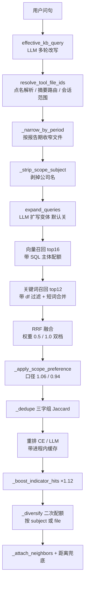

# 知识库检索功能审查报告

> 审查对象：`src/ai_agent/kb/`（retrieval / store / router / rerank / scope / meta / chunking）
> + `src/ai_agent/tools/kb_search.py`
> 语料实测：10 份就绪文件、314 个切片、6 家主体（本地 pgvector 实库查询，非推断）
> 结论先行：**数据层有一处真实缺陷（`subject` 列被污染），性能层有三处浪费；
> 但"策略层过度工程"这一定性已被消融实验推翻**——见下方修订记录。

---

## 修订记录（2026-11-02 晚，补全 72 条评测集后重测）

用户补了 `scripts/retrieval_eval_cases_corpus.json`（72 条，7 个分组，每条带 note），
并指出"步骤多是有原因的"。我用这份集做了消融实验（`scripts/ablate_retrieval.py`），
**上一版的定性有三处需要修正**：

| 上一版结论 | 实测后修正 |
|---|---|
| "策略层过度工程，建议逐个证明价值、证不了就删" | **大部分错**。11 个步骤里 8 个有正收益，其中混合检索一关就从 89% 掉到 50% |
| A1 subject 污染 = P0 / "最值钱的一个 bug" / 吃掉 top_k 名额 | **高估了端到端影响**。分桶修好后 hit@3 持平、MRR 仅 +0.006、1 好 1 坏 → 降为 **P2 数据卫生** |
| B2 短词合并"为窄问法付全表 regexp，建议删" | **错了**。关掉后 hit@3 −2.8%、MRR −0.031、6 条变差 0 条变好，是真有用 |

保留不变的部分：`subject` 列确实存了非主体字符串（事实）；三处性能浪费（事实）；
评测集与语料脱节（已被这次补集解决，剩下多轮/延迟两类没覆盖）。

---

## 1. 现状：一次 kb_search 实际要走的 15 步



每一步都有注释解释 why，工程态度是好的。问题是**步数太多、常数太密、而证明它们有效的证据太少**。

---

## 2. A 类：做错了（有实测证据）

### A1（P2，原判 P0 已被实测下调）`subject` 列被 ingestion 污染，而 SQL 配额在吃这一列

**现象**（实库查询）：

```
每份文件的切片 subject 去重数：
  10 种 / 37 片  中化装备科技(青岛)股份有限公司2026年第三季度报告
  10 种 / 68 片  中国能源建设股份有限公司2026年第三季度报告
   8 种 / 38 片  中国银行股份有限公司2026年第三季度报告
   7 种 / 33 片  长安汽车有限公司2026年第三季度报告
```

出现的"主体"包括：`股份有限公司`、`公开发行证券`、`向中央银行`、`提取保险`、
`股东王丽芳通过中信证券股份有限公司`、`辰致汽车科技集团有限公司`。

**根因**：`kb/meta.py:assign_chunk_subjects` 用 `_COVER_COMPANY` 正则
（`[\u4e00-\u9fff]{2,24}(?:股份有限公司|...|银行|证券|保险|基金)`）从整篇正文里捞候选主体，
只要候选 ≥2 就逐片分配。单主体季报里：
- 《公开发行证券的公司信息披露解释性公告》→ `公开发行证券`
- 「向中央银行借款」→ `向中央银行`（"银行" 命中后缀）
- 封面「中化装备科技（青岛）股份有限公司」全角括号截断 → `股份有限公司`

**后果**（实测）：以「中国银行封面切片」的向量查长安汽车文件：

| | 纯向量排序 | 生产 SQL（带主体配额，band=0.12） |
|---|---|---|
| 1 | seq0 d=0.3546 长安汽车有限公司 | seq0 d=0.3546 长安汽车有限公司 |
| 2 | seq32 d=0.3703 重庆长安汽车股份有限公司 | seq32 d=0.3703 重庆长安汽车股份有限公司 |
| 3 | **seq19 d=0.3711 长安汽车有限公司** | **seq20 d=0.4619 「提取保险」** ← 被提前 |
| 4 | seq25 d=0.3793 | seq19 d=0.3711 ← 被挤到第 4 |

`top_k=3` 时 1/3 的名额给了伪主体桶的头名。同一套污染还影响 `retrieval._diversify_by_subject`
（Python 层第二层配额）和将来任何 `subjects` 过滤。

**讽刺之处**：`_diversify_by_file` 的注释已经写了"股东表的切片主体会被改成股东名，
按切片 subject 分桶分不开"——症状早就发现，但做的是绕过（`per_file=True`），
不是修根因。绕过只覆盖了"多文件"这一种调用路径，SQL 层照样中毒。

**端到端影响实测（72 条）**：把 SQL 分桶与二次配额从 `c.subject` 换成干净的 `file_id`：

| | hit@1 | hit@3 | hit@10 | MRR |
|---|---|---|---|---|
| A 现状（c.subject） | 68% | 89% | 96% | 0.788 |
| B SQL 分桶改 file_id | 69% | 89% | 96% | 0.794 |
| C B + 二次配额也按 file | 69% | 89% | 96% | 0.794 |

ΔMRR +0.006，变差 1 条 / 变好 1 条。**即：这是一个真实的数据缺陷，但当前端到端
损害很小**（因为路由/点名已把范围收窄到 1~2 个文件，伪主体桶的破坏被范围吃掉了）。

它真正的风险在未来：一旦启用 `subjects` 过滤，或语料里出现真正的多主体文档
（行业研报、尽调报告），污染会从"轻微排序噪声"变成"整片查不到"。
因此定位是 **P2 数据卫生**，不是 P0 排序 bug。

### A2（P0）每次检索 4 次 DB，其中 2~3 次是全表扫描

`_retrieve_candidates` 一轮：
1. `search_kb_chunks` — ANN 索引，OK
2. `keyword_doc_freq` — `count(*) FILTER (WHERE c.text ILIKE '%kw%')` × 6 关键词，**全表**
3. `keyword_boundary_freq` — `count(*) FILTER (WHERE c.text ~ 'kw([^一-鿿]|$)')`，**全表正则**
4. `search_kb_chunks_keyword` — 6 个 ILIKE 的 CASE 求和，**全表**（无 trgm 索引时）

`ILIKE '%x%'` 用不上 btree；这三步随库容量线性增长。multi-query 开启时 ×3。
结果为常量（只依赖 keywords + file_ids），却每次现算、无缓存。

### A3（P1）`kb_chunk_neighbors` 把整个文件的切片全拉回 Python 再丢掉

`store.py:1012` 的 WHERE 只有 `file_id = ANY(...)`，`seq` 过滤在 Python 侧做。
文件 500 片就传 500 行全文，只为取其中 3~6 片。

### A4（P1）重排缓存永不失效

`retrieval.py:1081` `_rerank_cache[(query, sig)]`，无 TTL、无版本号。
`update_kb_chunk_text` 改了切片文本后，只要 `(query, file_id, seq)` 不变就一直返回旧分数。

### A5（P1）`_strip_scope_subject` 在对比问句上把检索词剥坏

多文件点名时 `names` 含两家全称/别名/文件名，逐条 `str.replace`：
`中国黄金和长安汽车的货币资金对比` → `和 货币资金对比`。
`len(stripped) < 2` 的回退判据拦不住它（长度够），于是 embedding 与关键词抽词用的是残句。
只有 `diversify_query` 保住了原句用于分档。

### A6（P2）三态返回值 + 报告期落空的文案错配

`resolve_files_by_name` 返回 `None / [] / list`，靠 `chosen == []` 判断。
`_narrow_by_period` 在"问句要 2024Q3、库里只有 2025/2026"时返回 `[]` →
工具回 `KB_NO_HIT_HINT`（"没查到"），而真实原因是"库里没有这一期"。用户据此换词重试是无效的。

---

## 3. B 类：做多了（收益未被证明 / 已经死掉）

| # | 项 | 判断 |
|---|---|---|
| B1 | 8 个手调常数：RRF 关键词权重 `0.5` / 全命中 `1.0`（注释里按 `w/61 > 1/76 → w>0.803` 反解，**硬依赖 `kb_search_candidates=16`**）、口径 `1.06/0.94`、指标加成 `1.12`、去重 `0.72`、band `0.12`、路由阈值 `0.55` vs 检索阈值 `0.72` | 改任一配置即失准，无测试保护，全部来自"实测某条 case" |
| B2 | `_apply_short_phrases`（短词合并：jieba 二次切分 + 一次全表词频） | ~~为「合并利润 / 合并利润表」这类窄问法，付每次检索一次全表 regexp~~ **撤回：消融显示关掉后 hit@3 −2.8%、MRR −0.031、6 条变差 0 条变好，是真有用。它的成本问题在于实现（全表扫描），不在功能本身——该做缓存，不该删** |
| B3 | `_keep_distinctive_keywords`（现算 df 过滤通用词） | 思路对，实现错：该用 pg_trgm/tsvector 或离线 IDF 表，不该每次扫全表 |
| B4 | `search_knowledge_multi` 整套 multi-query 融合 | `kb_multiquery_enabled=False` 默认关闭，等于死路径，却维护了重复的 `_core_search` 逻辑 |
| B5 | `query_looks_on_topic` / `mentioned_subjects` / `mentioned_entities` | 全仓无调用点（grep 确认），纯死代码 |
| B6 | `filters` 的 `periods` / `subjects` 两维 | 生产代码从不传；`scopes` 也只在命中「母公司\|单体」时才传 |
| B7 | 重排后再叠一层 `_diversify_by_subject` | SQL 层已按 subject 分过一次桶，两层配额 + 两套分桶（subject/file）逻辑重复 |
| B8 | figure 链路 | 库里 figure 切片 **0 个**，`format_where` 的图表分支与「（图像识别，可能有误差）」文案目前打不到 |

---

## 4. C 类：该做没做

- **C1 评测集与语料脱节**：`retrieval_eval_cases.json` 25 条 / 7 文件、`_3f.json` 20 条 / 2 文件，
  而库里 10 份 / 6 家主体。通过线 `hit@3 ≥ 0.85` 在 20 条样本上 = 允许 3 条失败，
  统计上区分不出 5pp 的差异——`kb_filter_eval_report.md` 第 3 节"无法确认精度提升"正是这个原因。
  **建议 ≥60 条**：6 家 × 3 类问法（指标 / 股东 / 跨期对比）+ 边界（库里没有的年份、母公司口径）
  + 对抗（提示注入、跨用户越权）。并把 `scripts/eval_retrieval.py` 接进 CI（现在靠手工跑）。
- **C2 无可观测**：检索链路没有 span 埋点，只有几行 `logger.info`。出问题只能 `--dump` 手跑。
  建议在 `retrieve_for_question` 打一条结构化日志：query / 圈定的 file_ids / 候选数 /
  各阶段耗时 / 最终 top_k 的 (file, seq, score, subject, kind)。
- **C3 无灰度回滚**：重排后端、band、权重全是全局配置，改即全量。
- **C4 无延迟/成本基线**：现在无法回答"开 multi-query 后 P95 涨了多少"。

---

## 5. 修复补丁（完整可运行）

### 5.1 止血：把 chunk.subject 重置为文件主体

多主体归属只对真正的多主体文档（行业研报）有必要，而且现在的判据根本不可靠。
先把存量纠正回"默认继承文件主体"：

```sql
-- 备份（downgrade 前先 pg_dump；这里只改一列，仍建议先备份）
UPDATE agent_kb_chunk c
SET subject = f.subject
FROM agent_kb_file f
WHERE f.id = c.file_id;

-- 验收：单主体文件的 distinct subject 应为 1
SELECT f.filename, count(DISTINCT c.subject) AS s, count(*) AS n
FROM agent_kb_chunk c JOIN agent_kb_file f ON f.id = c.file_id
GROUP BY f.filename ORDER BY s DESC;
```

期望：除行业研报外全部 `s = 1`。当前实测 4~10。

### 5.2 治本：`kb/meta.py` 给候选主体加可用判据

替换 `assign_chunk_subjects` 中的候选构造段（`src/ai_agent/kb/meta.py:400` 附近）：

```python
# 以这些字开头的一律不是主体名：它们是句子或科目行的前半截。
# 「向中央银行借款」被 _COVER_COMPANY 切成「向中央银行」正是这么来的。
_NON_SUBJECT_LEAD = frozenset("向提取公开发行的和及与对为在被把从给由第各")


def _plausible_subject(name: str) -> bool:
    """这个名字够不够格当「主体」。

    _COVER_COMPANY 只保证「后面跟着公司/银行/证券这类后缀」，前面那 2~24 个
    字是什么完全不管——《公开发行证券的公司信息披露…》因此被切成
    「公开发行证券」，并一路污染到 subject 列。这里补两道闸：核心名 ≥4 字，
    且首字不在「不像主体」的黑名单里。宁可漏（退回文件主体），不可错——
    抽错主体比抽不到更糟，它会让该主体的切片整体查不到。
    """
    if not name:
        return False
    core = subject_core(name)
    if len(core) < 4:
        return False
    if core[0] in _NON_SUBJECT_LEAD:
        return False
    return bool(COMPANY_SUFFIX.search(name))


def assign_chunk_subjects(
    texts: list[str],
    default: str,
    library: list[tuple[str, list[str]]],
) -> list[str]:
    """正文里出现至少两家公司时，按提及次数给每片定主体。否则整份继承文件主体。"""
    if not texts:
        return []
    blob = "\n".join(texts)
    candidates: list[tuple[str, list[str]]] = []
    known: set[str] = set()
    for subject, aliases in library:
        subject = (subject or "").strip()
        if not subject or subject in known:
            continue
        known.add(subject)
        candidates.append((subject, list(aliases or []) or extract_aliases(subject)))
    for name in _COVER_COMPANY.findall(blob):
        # 只有够格的名字才进候选。漏掉一家次要公司，代价远小于把
        # 「公开发行证券」写成主体——后者会让 SQL 的 PARTITION BY subject
        # 多出一个伪桶，凭空吃掉一个名额。
        if name not in known and _plausible_subject(name):
            known.add(name)
            candidates.append((name, extract_aliases(name)))
    appearing = [
        (subject, forms)
        for subject, forms in candidates
        if count_mentions(blob, forms) > 0
    ]
    if len(appearing) < 2:
        return [default] * len(texts)
    return [
        pick_chunk_subject(text, appearing, default=default) for text in texts
    ]
```

依赖：无新增。`COMPANY_SUFFIX` 与 `subject_core` 同文件已定义。

### 5.3 `kb/store.py`：邻接查询只取需要的 seq

完整替换 `kb_chunk_neighbors`（`src/ai_agent/kb/store.py:988`）：

```python
    def kb_chunk_neighbors(
        self,
        pairs: list[tuple[uuid.UUID, int]],
        *,
        radius: int = 1,
    ) -> dict[tuple[str, int], list[dict]]:
        """命中切片的相邻片段：{(file_id, seq): [{seq, page, kind, text}...]}。

        (file_id, seq) 一起下推到 SQL：原先只按 file_id 过滤，等于把整份文件
        的切片（含正文全文）全拉回 Python 再丢掉九成。文件越大浪费越多。
        """
        if not pairs or radius <= 0:
            return {}
        wanted = {
            (str(file_id), seq + delta)
            for file_id, seq in pairs
            for delta in range(-radius, radius + 1)
            if seq + delta >= 0
        }
        ids = [fid for fid, _ in wanted]
        seqs = [seq for _, seq in wanted]
        with self._get_pool().connection() as conn:
            rows = conn.execute(
                """
                SELECT c.file_id, c.seq, c.page, c.kind, c.text
                FROM agent_kb_chunk c
                JOIN unnest(%(ids)s::uuid[], %(seqs)s::int[]) AS t(fid, sq)
                  ON t.fid = c.file_id AND t.sq = c.seq
                """,
                {"ids": ids, "seqs": seqs},
            ).fetchall()
        grouped: dict[tuple[str, int], list[dict]] = {}
        for row in rows:
            key = (str(row["file_id"]), int(row["seq"]))
            grouped.setdefault(key, []).append(
                {
                    "seq": int(row["seq"]),
                    "page": row["page"],
                    "kind": row["kind"],
                    "text": row["text"],
                }
            )
        return grouped
```

### 5.4 `kb/retrieval.py`：关键词 df 加缓存（砍掉 2 次全表扫描/轮）

先在 `core/config.py` 增一行：

```python
    # 关键词文档频次缓存秒数：df 只随库内容变化，不必每次检索重算全表
    kb_df_cache_seconds: float = 300.0
```

再在 `retrieval.py` 加缓存函数，并把 `_keep_distinctive_keywords` 与
`_apply_short_phrases` 里的 `store.keyword_*_freq(...)` 换成它：

```python
import time

_DF_CACHE_MAX = 512
# (关键词元组, file_ids 元组) -> (写入时刻, 结果)。dict 保插入序，超容量弹最旧。
_df_cache: dict[tuple, tuple[float, tuple[int, dict[str, int]]]] = {}


def _keyword_freq_cached(
    fn, keywords: list[str], file_ids: list[uuid.UUID] | None
) -> tuple[int, dict[str, int]]:
    """缓存文档频次统计。

    「营业收入」这种词的 df 在库内容不变时是常量，每次检索重扫全表纯属浪费。
    失效靠 kb_df_cache_seconds：新入库的文件最多晚 5 分钟反映到关键词路，
    换来的是每次检索少两次全表扫描（ILIKE ×6 + regexp）。库内容变化频繁时
    把这个值调小即可。
    """
    key = (
        fn.__name__,
        tuple(keywords),
        tuple(sorted(str(f) for f in (file_ids or []))),
    )
    now = time.monotonic()
    hit = _df_cache.get(key)
    if hit and now - hit[0] < settings.kb_df_cache_seconds:
        return hit[1]
    value = fn(keywords, file_ids=file_ids)
    _df_cache[key] = (now, value)
    if len(_df_cache) > _DF_CACHE_MAX:
        _df_cache.pop(next(iter(_df_cache)))
    return value
```

调用点改为：
`_keyword_freq_cached(store.keyword_doc_freq, keywords, file_ids)` 与
`_keyword_freq_cached(store.keyword_boundary_freq, [p for p, _, _ in pairs], file_ids)`。

### 5.5 `tools/kb_search.py`：多文件时不剥公司名

在 `_strip_scope_subject` 开头加一道闸（替换 `if not names: return query` 之后的部分）：

```python
    # 点名多家时不能逐个 replace：两家的名字都被删掉，检索词只剩连接词
    # （「中国黄金和长安汽车的货币资金对比」→「和 货币资金对比」），
    # 嵌进去的是一个残句。多家对比靠 diversify_query 保留原句分档就够了。
    if len(set(file_ids)) >= 2:
        return query
```

### 5.6 验收命令

```bash
# 1) 单元测试不回归
uv run pytest tests/test_kb_retrieval.py tests/test_kb_subject_query.py \
             tests/test_kb_meta.py tests/test_eval_retrieval.py -q

# 2) subject 污染是否清除
uv run python -c "
from ai_agent.memory.store import store
with store._get_pool().connection() as conn:
    for r in conn.execute('''SELECT f.filename, count(DISTINCT c.subject) s, count(*) n
        FROM agent_kb_chunk c JOIN agent_kb_file f ON f.id=c.file_id
        GROUP BY f.filename ORDER BY s DESC'''):
        print(f\"{r['s']:>3} 种 / {r['n']:>3} 片  {r['filename'][:44]}\")
"
# 期望：单主体文件 s == 1

# 3) 检索质量回归（先扩到 ≥60 条再跑）
uv run python scripts/eval_retrieval.py --cases scripts/retrieval_eval_cases.json
# 期望：hit@3 ≥ 0.85，且与改动前逐条对比名次变化
```

---

## 6. 优先级清单

| 优先级 | 动作 | 预期收益 | 成本 |
|---|---|---|---|
| P2 | 重置 chunk.subject + 加 `_plausible_subject` 判据 | 端到端 +0.006 MRR；主要价值是防止启用 subjects 过滤 / 接入多主体文档后变成硬伤 | 半天 |
| P0 | `kb_chunk_neighbors` 下推 seq | 邻接查询传输量降 1~2 个数量级 | 1 小时 |
| P0 | 关键词 df 缓存 | 每轮检索少 2 次全表扫描 | 2 小时 |
| P1 | 重排缓存加 TTL/版本号 | 消除切片修订后的陈旧排序 | 1 小时 |
| P1 | 评测集扩到 ≥60 条 + 进 CI | ~~让"这个改动有没有用"可被回答~~ **已完成：72 条 corpus 集，7 分组，含对抗与边界。剩下的是进 CI + 补多轮** | 1 天 |
| P1 | 给短词合并 / 关键词路加 df 缓存（**不是删**） | 保留精度，砍掉每轮 2 次全表扫描 | 2 小时 |
| P1 | 修 `_strip_scope_subject` 多文件分支 | 对比问句不再用残句检索 | 1 小时 |
| P1 | 补多轮评测集（当前 72 条全单轮，测不出改写能力） | 让"多轮改写"这一步有信号 | 1 天 |
| P2 | 拆 `file_subject` / `chunk_subject` 两列 | 一列两个语义是万恶之源 | 半天 + 迁移 |
| P2 | 检索链路埋点（trace_id span + 阶段耗时） | 线上问题可定位 | 1 天 |
| P2 | 逐个 A/B 删除 B2/B3/B7，用评测集证伪 | 每删掉一个，链路少一处不确定性 | 每项半天 |
| P3 | figure/vision 链路产出验证或下线 | 消除"有代码无数据"的假象 | 半天 |

**关于"真的需要这么复杂吗"（已按消融结果重写）**：上一版我建议"逐个证明价值、
证不了就删"。72 条消融跑完后，这个说法对一半错一半——
11 个受测步骤里 8 个有正收益，混合检索一项就值 39 个百分点的 hit@3。
链路长不是原罪，**每一步有没有价签才是**。修正后的做法：

1. **别删有价签的**：混合检索 / 短词合并 / 二次配额 / 口径偏好 / 主体名剥离，全部留着；
2. **性能优化要绕开功能**：短词合并与关键词路的问题是"每次全表扫描"，
   解法是缓存 df（见 5.4），不是删功能；
3. **Δ=0 的三步分两类处理**：
   - `多轮改写` —— 是评测集设计盲区（72 条全是单轮问句，物理上测不出多轮能力），
     该补的是多轮用例，不是删代码；
   - `指标名加成 1.12` / `去冗余 dedupe` —— 真没信号。做法是先补能触发它们的用例
     （指标名加成需要"指标名出现在 meta.indicators 里"的问法，dedupe 需要切片
     高度重叠的场景），补完还是 0，再删。
4. **每次加系数都要带价签**：新增/调整一个常数，必须同时给出"关掉它掉几分"的
   消融数字，否则不许进主干——这是防止链路继续膨胀的唯一硬闸门。

---

## 7. 附录：消融实验完整结果（72 条，重排关闭）

复现命令：`uv run python scripts/ablate_retrieval.py`
（用例集 `scripts/retrieval_eval_cases_corpus.json`，窗口 top_k=10，重排关闭测纯检索质量）

| 关掉的步骤 | hit@1 | hit@3 | hit@10 | MRR | Δhit@3 | ΔMRR | 变差 | 变好 |
|---|---|---|---|---|---|---|---|---|
| **基线（全开）** | 68% | 89% | 96% | 0.788 | — | — | — | — |
| 混合检索（关键词路） | 35% | **50%** | 88% | 0.473 | **−38.9%** | **−0.314** | 41 | 4 |
| 短词合并 | 64% | 86% | 96% | 0.757 | −2.8% | −0.031 | 6 | 0 |
| 二次配额 diversify | 68% | 86% | 94% | 0.776 | −2.8% | −0.011 | 3 | 0 |
| 文档路由 | 65% | 86% | 93% | 0.766 | −2.8% | −0.022 | 11 | 10 |
| 主体名剥离 | 60% | 88% | 99% | 0.742 | −1.4% | −0.045 | 9 | 4 |
| 口径偏好 1.06/0.94 | 67% | 88% | 96% | 0.779 | −1.4% | −0.009 | 2 | 1 |
| 报告期收窄 | 67% | 89% | 92% | 0.768 | ±0.0% | −0.020 | 5 | 1 |
| df 稀有词过滤 | 68% | 89% | 96% | 0.784 | ±0.0% | −0.004 | 2 | 2 |
| 指标名加成 1.12 | 68% | 89% | 96% | 0.788 | ±0.0% | ±0.000 | 0 | 0 |
| 去冗余 dedupe | 68% | 89% | 96% | 0.788 | ±0.0% | ±0.000 | 0 | 0 |
| 多轮改写 | 68% | 89% | 96% | 0.788 | ±0.0% | ±0.000 | 0 | 0 |

逐条怎么读：

- **混合检索是命根子**：41 条变差 / 4 条变好，hit@3 直接腰斩（89% → 50%）。
  向量路在这个语料上扛不住"精确字段名 + 数字"，关键词路才是主力。
  任何动到关键词路的改动，都要先跑这一项。
- **主体名剥离是精度/召回的权衡**：hit@1 −8pp、MRR −0.045（顶部精度明显掉），
  但 hit@10 反而 +3pp。它换的是"前 3 名更准"，代价是 4 条被挤出前 10。
  工具默认 top_k=3，所以这个权衡值得。
- **文档路由 11 变差 / 10 变好**：净掉 2.8%，说明它在半数用例上救场、半数上帮倒忙。
  这是下一步最值得细看的一项——把那 21 条的 query 列出来，大概率能找到一个更准的
  判据（比如"点名已命中时不要再用摘要结果补充"）。
- **报告期收窄**：hit@3 不动，但 hit@10 −4pp、MRR −0.020、5 条变差。
  它砍掉的长尾里有真需要跨期的问法；边界组那 3 条（问 2024 年、库里只有 2025/2026）
  正卡在这里。

## 8. 待确认清单

- `[待核实]` `kb_search_max_distance=0.72` / `kb_doc_route_max_distance=0.55` 两个阈值与当前
  `EMBEDDING_MODEL` 的距离分布是否匹配：核实方式是跑一次
  `scripts/eval_retrieval.py --dump` 后的切片，统计"相关片距离 vs 无关片距离"的分布，
  阈值应落在两者之间。不同嵌入模型的余弦距离不可直接套用。
- `[待核实]` `figure` 切片为 0 的原因（是识别没触发，还是这批 PDF 确实没有图表）：
  核实方式是对 `data/uploads` 里的一份 PDF 跑 `scripts/kb.py` 的解析，看
  `kb/figures.py` 的三道筛（文字密度 / 位图面积 / 矢量路径）命中情况。
- `[待核实]` `ruff check` 当前有 4 个未修告警（3×E702 + 1×F401），与 README 声称的
  "ruff 零告警"不一致：核实方式是 `uv run ruff check src tests scripts`。
- `[待核实]` 未验证 embedding / LLM 网关在当前环境是否可达，因此本报告未给出
  端到端的延迟与成本基线数字；上述性能结论来自代码路径与 SQL 形态分析，非实测耗时。
